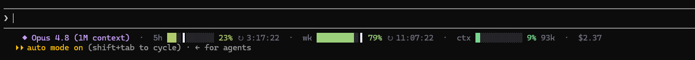

# burnline

A Claude Code statusline that shows your rate-limit usage with live countdowns.



Bars shade mint → amber → coral as quota burns.

## What it shows

- **Model** — the active model's display name.
- **5h** and **wk** — your 5-hour and 7-day rate-limit windows.
- **ctx** — how full the context window is, with an approximate token count.
- **$** — the session cost so far.

### Reading the rate-limit bars

Each rate-limit bar packs two things into one strip:

- The **filled portion** (`█`) is how much of your quota you've burned.
- The **`┃` tick** marks where the reset clock currently sits in the window.

So:

- Fill **short of** the tick → you're ahead of the clock, you have headroom.
- Fill **past** the tick → you're burning faster than the clock; you'll run out before it resets.
- **`↻`** shows the reset: a live `H:MM:SS` countdown when it's under a day away, otherwise the day and hour it lands (e.g. `Sun 9am`).
- **`⏸`** appears only when you're ahead of the clock — it's how long you could idle for the clock to catch up to your usage.

## Install

```sh
npx -y burnline
```

That's it. It patches `~/.claude/settings.json` to register the statusline, preserving your other settings. Restart Claude Code (or start a new session) and it appears.

### Manual install

Prefer to edit the config yourself? Add this to `~/.claude/settings.json`:

```json
{
  "statusLine": {
    "type": "command",
    "command": "npx -y burnline",
    "padding": 2,
    "refreshInterval": 1
  }
}
```

## Requirements

- Node.js >= 18
- A terminal with truecolor (24-bit) support and a font that includes the block/box-drawing glyphs (`█ ░ ┃ ◆ ↻ ⏸`).

## Privacy

burnline only reads the status JSON that Claude Code already pipes to it on stdin, and writes the rendered line to stdout. It makes no network requests, sends nothing anywhere, and has no telemetry and no dependencies.

## License

MIT © Vijeth-Rai
